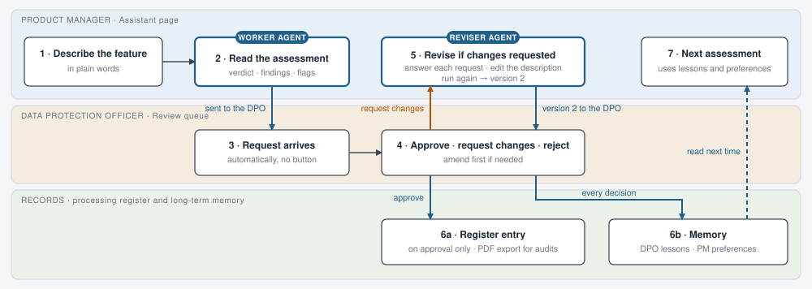
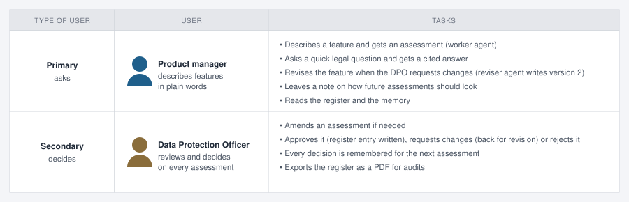
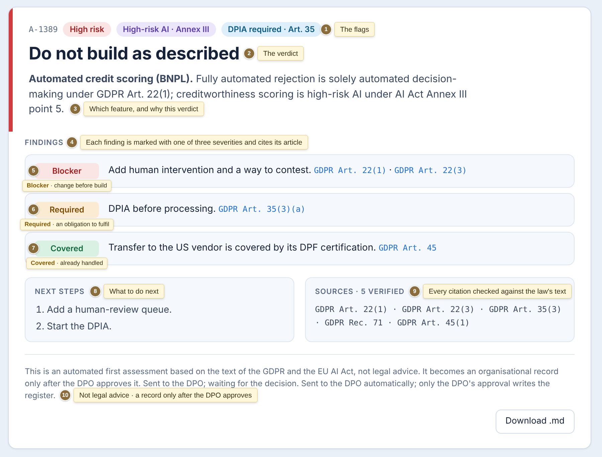
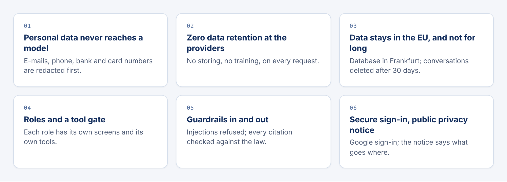

# Compliance Assistant

**Turns a plain-language description of a planned feature into an article-cited GDPR / EU AI Act assessment, and records it in the organisation's processing register once the Data Protection Officer (DPO) approves.**

LangGraph orchestrator • FastAPI backend • Multi-agent workflow • Agentic RAG • Human-in-the-loop • Guardrails • Long-term memory and learning from feedback • OIDC authentication and role-based privileges • Evaluation with an LLM judge

**Links**

| Where | Link |
|---|---|
| Project website | [complianceassessmentagent-site.vercel.app](https://complianceassessmentagent-site.vercel.app) |
| Live app sign in with Google to use the app as a product manager | [compliance-web-qo1l.onrender.com/login](https://compliance-web-qo1l.onrender.com/login) free tier: may take a minute to wake up |
| Evaluation report (no login) | [compliance-web-qo1l.onrender.com/evaluation](https://compliance-web-qo1l.onrender.com/evaluation) |
| Turing College showcase | [showcase.turingcollege.com/project/6dc8696f…](https://showcase.turingcollege.com/project/6dc8696f-3399-4ddd-9ae9-f93a8088cac6) |

The app is containerised with Docker: `docker compose up --build` starts the database, the API and the front end, then open http://localhost:3000 (details in [TECHNICAL.md](TECHNICAL.md)).

**Corpus**: GDPR (99 articles, 173 recitals) and the EU AI Act (113 articles, 180 recitals, 14 annexes) from EUR-Lex, chunked by article / paragraph / recital / annex point into ~1,270 rows in Postgres (pgvector + full text). Articles and annexes come from the consolidated texts, recitals from the original Official Journal texts.

Docs for deep-dive: [AGENTS.md](AGENTS.md) (how the agent works: the graph, the nodes, retrieval, agentic RAG, middleware) · [TOOLS.md](TOOLS.md) (tool inventory, permissions)

Refer [TECHNICAL.md](TECHNICAL.md) for setup, tests, housekeeping

## 1. What it does and who it is for

An assistant that answers "can we build this?" for product teams, with the exact GDPR and AI Act articles behind the answer, and turns the approved answer into an organisational record.

The product manager describes the feature and reads the assessment. The assessment goes to the DPO automatically, who amends, approves, requests changes or rejects it. An approval writes the register. A change request goes back to the product manager; after the revision, a second agent produces version 2 for the DPO. What the DPO decides is remembered for the next assessment.

**The two agents**

- The **worker** assesses a feature from scratch: it reads the long-term memory, searches the law and writes the assessment that goes to the DPO.
- The **reviser** runs only when the DPO has requested changes and the product manager has revised the feature. It does not start over: it takes the first assessment, updates only the findings affected by the changes, and leaves the rest as it was. The DPO then reviews only what changed.

**Users and their tasks**

The two roles are kept apart on purpose: the product manager asks and the DPO decides, so nobody approves their own draft (separation of duties).

### 1.1 The assessment (on the product manager's side)

The verdict (2) is one of three:

- **Proceed**: the feature can be built as described.
- **Proceed with conditions**: it can be built once the Required findings are met.
- **Do not build as described**: at least one Blocker; the feature must change first.

Each finding (4) is marked with one of three severities: **Blocker** (must change before build), **Required** (an obligation to fulfil) or **Covered** (already handled, often by an organisation fact from memory).

The flags (1) are three: **High risk** is the overall risk level (low, medium or high); **High-risk AI** means the feature is a high-risk AI system under the AI Act; **DPIA required** means a data protection impact assessment must be done first (GDPR Art. 35).

Under the card, the page shows the review status: sent to the DPO automatically, then approved, changes requested or rejected.

Before assessing, the worker checks the processing register, so it can say when a feature is already recorded there (for example as A-0012).

**Preference note**: once the DPO has decided (or at once for a quick answer), the product manager can leave a note such as "shorter findings, cite the recital too". It is stored as that user's own preference and applied to their future assessments.

**Good example**: the DPO can keep an approved assessment as an example; the assistant follows it in future assessments.

### 1.2 Revision (after the DPO requests changes)

When the DPO requests changes, nothing is recorded and the conversation is not over: it pauses for the product manager.

<table>
<tr>
<td width="50%" valign="top"><b>The product manager's side</b></td>
<td width="50%" valign="top"><b>The DPO's side</b></td>
</tr>
<tr>
<td valign="top"></td>
<td valign="top"></td>
</tr>
<tr>
<td valign="top">The product manager answers each request with done or not possible and a note, edits the feature description and runs the revision. The reviser then writes version 2.</td>
<td valign="top">Version 2 comes back to the review queue like any assessment. The DPO sees what changed, decides as before, and can request changes again (version 3). Only the requester can revise the thread.</td>
</tr>
</table>

How it works inside (the graph, the nodes, the agentic RAG loop, the middleware): [AGENTS.md](AGENTS.md).

## 2. Evaluation and result highlights

The full evaluation, with the test data, the results per set and the failure modes, is on the app's public evaluation page: [compliance-web-qo1l.onrender.com/evaluation](https://compliance-web-qo1l.onrender.com/evaluation) (no login needed; the same report as a PDF: `eval/report/evaluation.pdf`).

**Test data**: seven sets with 100 synthetic inputs written for this project (feature descriptions, legal questions, injection attempts), each with the expected route, provisions, verdict and findings. I used synthetic data rather than a golden set of real cases because a golden set needs a legal expert to label it, and I am not one.

**Scoring**: exact rules wherever the output is structured, an AI judge with a written rubric from a model family the app never uses, and a blind human check of five cases (made on the run of 27 October). One run per case, on 16 November 2026.

**Result highlights**

**Where it falls short**: the right finding sometimes sits one severity step too high or too low, and the verdict is then sometimes one step off as well.

## 3. Compliance

A compliance tool has to practise what it checks. Every statement below can be verified in this repository: the code, the model configuration (`config/models.yaml`) and the gateway's documents and settings saved as evidence under `docs/Compliance/`.

**What leaves the app, and what stays**

| Leaves the app | Stays in the app's database (Frankfurt) |
|---|---|
| The feature description or question, after personal data is redacted | The processing register |
| The passages of law retrieved for it | The review decisions |
| The organisation facts the agent reads | The users and the long-term memory |

Where it goes: through OpenRouter, a model gateway in the United States, to the model providers behind it: OpenAI and Google for the app, Anthropic only for the evaluation's judge.

**Under what terms**

- The gateway's data-processing agreement is for enterprise accounts only; it cannot be signed for a demo app.
- The demo therefore runs under the gateway's terms and privacy policy, with zero data retention set on the account.
- Transfers to the US rest on the providers' standard contractual clauses, as stated in those documents.

The hosted demo processes no real personal data and asks its users not to enter any. The full notice is at [compliance-web-qo1l.onrender.com/privacy](https://compliance-web-qo1l.onrender.com/privacy).

## 4. The web app

The front end is React (Next.js). The backend is FastAPI. Every run is streamed live, so a page can follow a run it did not start. The product manager's window shows the DPO's decision as it happens.

| Role | Pages |
|---|---|
| Product manager | Assistant · Register · Memory |
| DPO | Review queue (the landing page) · Register with PDF export · Memory |

Every page shows what the agent is doing:

- a **progress card** while the agent works: the steps of the run, the memory it read, the tools it may use and the model;
- **Behind the scenes**, a panel on the right with three tabs: the **live graph** (the running node amber, finished nodes green, the path taken blue), the **trace** (one block per node, every tool call, the pause for the DPO) and the **run stats** (tokens and cost).

The app is deployed on Render. The Postgres database is hosted on Neon (Frankfurt). The project website is deployed on Vercel.

## 5. Architectural decisions

| Decision | Why | How it is measured or shown |
|---|---|---|
| **Agentic RAG** (grade the passages, rewrite, search again; ≤ 3 attempts) | One search often misses the decisive article | +19 % retrieval recall (19 of 20 against 16 of 20) |
| **Jev as router** (a classifier model instead of a traditional LLM; LLM as fallback) | Faster and cheaper than an LLM prompt | 44 of 45 inputs routed right. *Future*: cost and speed against the LLM router |
| **Human-in-the-loop** (the run pauses until the DPO decides) | A register entry is a human decision, not the requester's | Automated tests check that only the DPO's approval writes the register |
| **One Postgres in Docker** (corpus, register, threads, memory) | One command gives every machine the same database | A clean machine runs the app with one command; the hosted database uses the same schema |
| **Model-agnostic setup** (every model is one line in `config/models.yaml`) | Swap a model without a code change | Done three times during the project, no code touched. *Future*: a model-swap evaluation |
| **Sign-in with Google (OIDC)**, next to two seeded demo accounts | Real users sign in with an account they already have; the app, not Google, decides who is a DPO | Covered by tests: a first sign-in creates a product manager, allow-listed addresses become the DPO |

## 6. Production readiness and error handling

Two things keep the app healthy once it runs for longer than a demo. One rule governs every failure: nothing invents data or hides an error. The real error is logged. The trace or the page says what happened. The result is never one that looks fine while something went wrong.

These behaviours are covered by the automated tests. The retention command and the housekeeping scripts are in [TECHNICAL.md](TECHNICAL.md).

## 7. Limitations and future scope

**Known limitations**

- The evaluation uses synthetic test data. It has not been run against a golden set of real cases reviewed by an expert in the GDPR and the EU AI Act.
- The EU AI Act changes often. The app has no way to track those changes; the corpus is a snapshot and has to be re-ingested by hand.

**Future scope**

- An evaluation on a golden set, with the expectations reviewed by a legal expert.
- A cost and speed comparison of the Jev router against the LLM router.
- A model-swap evaluation: the same test sets with other models in the worker and embedding slots.
- A third agent that tracks changes to the EU AI Act and updates the corpus.
